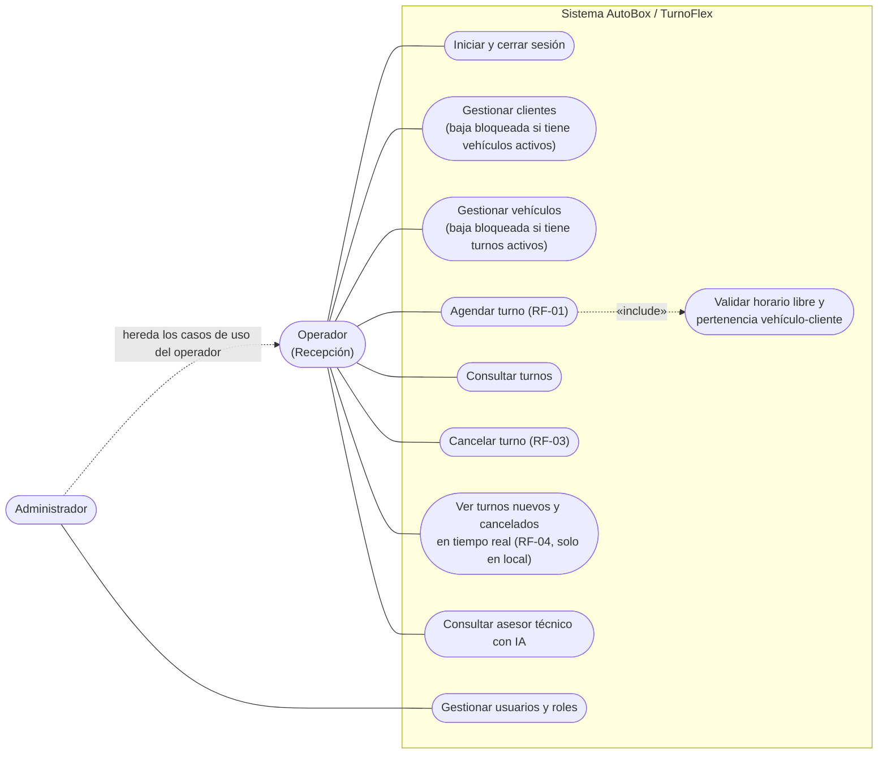
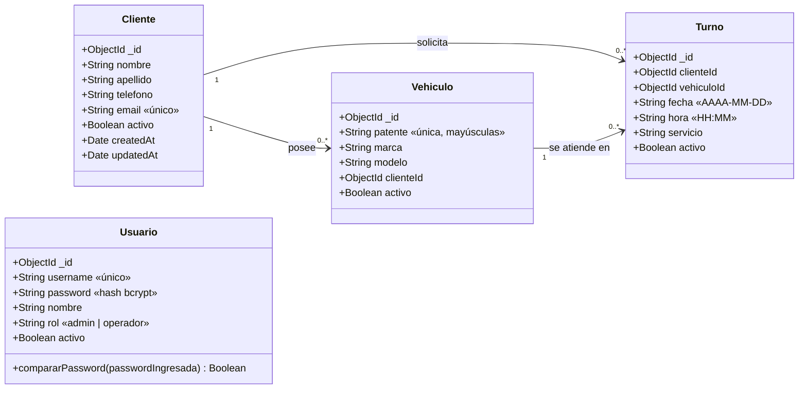
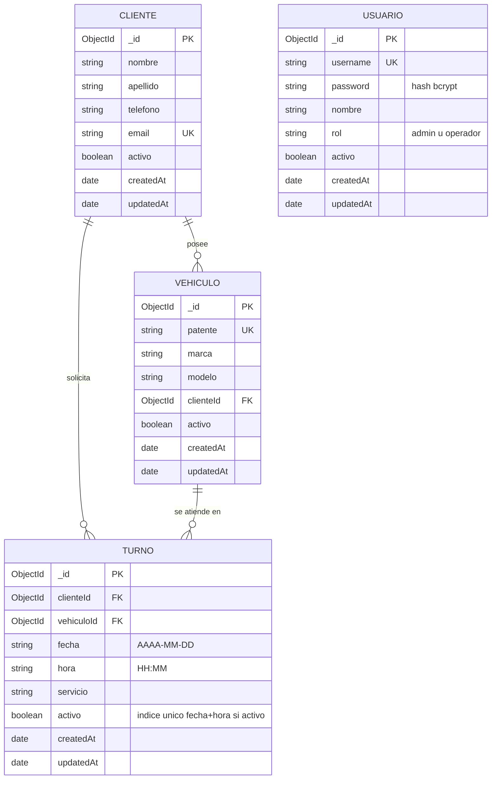
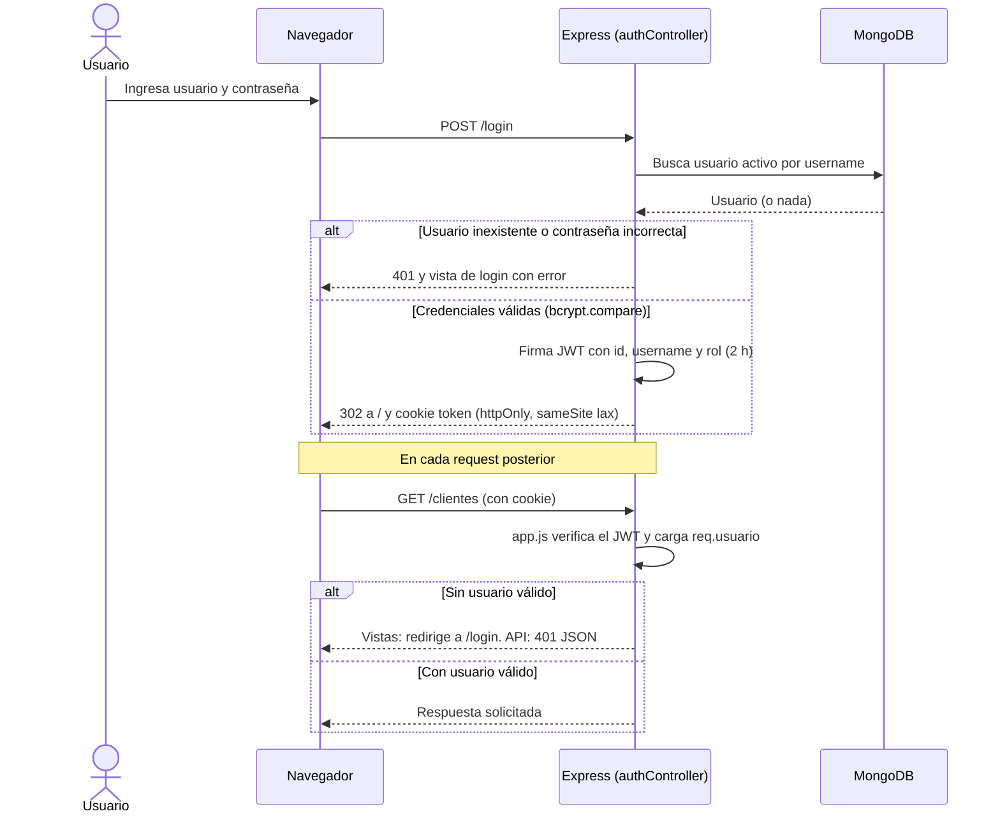
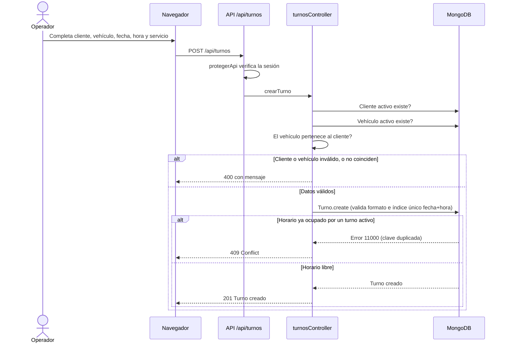
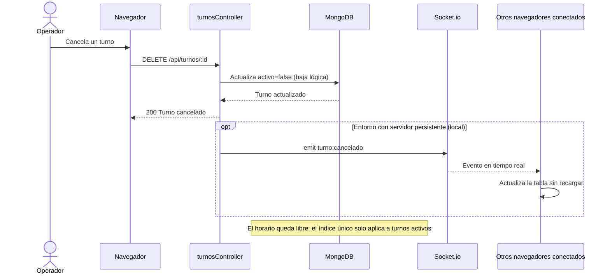

# Diagramas de AutoBox (Versión 1.1)

Los diagramas están escritos en [Mermaid](https://mermaid.js.org/): GitHub los muestra renderizados en este archivo. Para el documento PDF hay una imagen PNG de cada uno en `docs/img/`, y el código fuente editable en `docs/diagramas/`.

## Diagrama de casos de uso

Actores y funcionalidades implementadas. Entre paréntesis, el requerimiento del documento de Ingeniería de Software que cubre cada una. El administrador hereda todo lo del operador y suma la gestión de usuarios.

Imagen para el PDF: `docs/img/01-casos-de-uso.png`

## Diagrama de clases (modelos)

Los cuatro modelos de Mongoose. Las asociaciones se implementan con referencias `ObjectId` y se consultan con `.populate()`.

Imagen para el PDF: `docs/img/02-clases.png`

## Modelo entidad-relación

Colecciones de MongoDB. `PK` clave primaria, `FK` referencia a otra colección, `UK` índice único. Turno tiene además un índice único parcial (`fecha` + `hora`) que solo rige para turnos activos.

Imagen para el PDF: `docs/img/03-er.png`

## Diagrama de secuencia: inicio de sesión y verificación del JWT

Autenticación con JWT en cookie `httpOnly`. `app.js` verifica el token en cada request y deja el resultado en `req.usuario`.

Imagen para el PDF: `docs/img/04-secuencia-login.png`

## Diagrama de secuencia: reserva de un turno

Incluye las validaciones de integridad y la regla de horario ocupado (`409 Conflict`).

Imagen para el PDF: `docs/img/05-secuencia-reserva.png`

## Diagrama de secuencia: cancelación de un turno

Baja lógica y notificación en tiempo real. El paso por WebSocket solo funciona en entornos con servidor persistente (local); en Vercel está deshabilitado.

Imagen para el PDF: `docs/img/06-secuencia-cancelacion.png`

